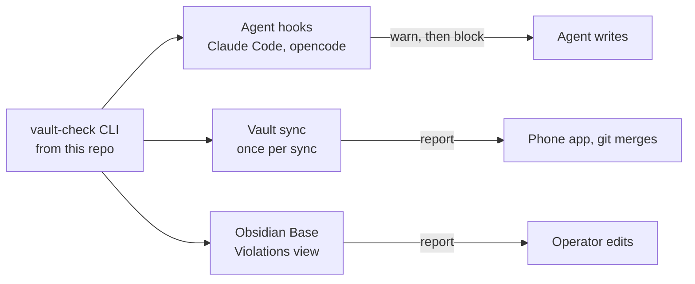

# One set of rules for writing to the vault

- **Status:** accepted
- **Date:** 2026-11-26

## Context

The vault holds two note systems at once. The old one sorts notes by
PARA folders: `20-Projects`, `30-Areas` and `40-Resources`. It marks a
project with `kind: project`. The new one sorts notes by kind, in link
form, and keeps each kind in its own folder: `Deeds`, `Notes`,
`References`, `Waypoints`, `Tasks`, `Journal` and `Agents`.

Three rule files describe the vault, and they disagree:

- The vault's root `AGENTS.md` still describes PARA. It lists
  `kind: task` and `kind: project`.
- The `vault-system-spec` note also describes PARA, and two copies of
  it exist.
- This repo's `VOCABULARY.md` describes the new kinds. It covers only
  tasks, deeds and lists.

An agent that reads them cannot tell which format is right. The
`Agents/` folder shows the result. On 2026-11-26 it held 15 notes at
its top level. 8 of them say `kind: "[[notes]]"`, 6 have no
frontmatter, and 1 has tags only. 3 carry a `status`. 19 more notes
sit in subfolders. `kind: "[[notes]]"` marks the operator's own
thinking, so these agent notes mix with it.

Nothing checks a write today. A wrong note stays wrong until the
operator finds it by hand.

## Decision

The new note system is the only one. Every note kind gets a contract
in this repo, and one checker enforces every contract.

- **One system.** The vault uses the kinds and folders of the new
  system. The PARA tree and `kind: project` retire. Their notes move
  later, in a separate tidy.
- **A contract per kind, in phases.** Phase 1 covered tasks and deeds.
  This record adds agent notes and the journal. Notes, references and
  waypoints come later.
- **Zod in this repo is the single source.** The schemas stay in
  `packages/schemas`. We export JSON Schema only when a client that is
  not TypeScript needs it.
- **Agent notes are their own kind.** An agent writes
  `kind: "[[agents]]"` into the flat `Agents/` folder. It needs
  `created` and at least one link in `categories`. It may add `types`
  and `tags`. It has no `status`. Lists of agent notes come from an
  Obsidian Base, not from subfolders.
- **`kind: "[[notes]]"` stays the operator's.** Those notes hold the
  operator's own thinking, so the operator never hands that
  understanding to an agent. Agents never create one. An agent edit
  to one warns and does not block.
- **Types come from existing notes.** Each `types` link on an agent
  note must point to a note that already exists. Agents cannot invent
  new types.
- **The journal keeps its own grammar.** Daily notes live in
  `Journal/Daily/YYYY-MM-DD.md`. They are the monkey-tasks journal, and
  monkey-tasks ADR `20261112-journal-format` owns what goes inside. The
  contract names only the folder and the file name, which must be a
  real local date. A journal note needs no frontmatter. The checker never
  blocks a journal write.
- **Agent output has three homes.** A repo holds anything about one
  codebase. OpenChamber holds live working state. That means plans in
  flight, todos and memory. The vault's `Agents/` folder holds only what
  the operator reads or keeps. Examples are handovers, research and
  notes about the life system.

### How the rules get enforced

Later PRs build the enforcement. We record the design here, so each
piece follows it.

- **One rule engine.** A `vault-check` command from this repo holds
  every rule. Nothing else holds a copy.
- **Agents meet it through thin hooks.** A Claude Code `PreToolUse`
  hook and an opencode `tool.execute.before` hook call the checker
  before an agent writes a note.
- **The sync covers the rest.** The vault sync runs the checker once
  per sync. That catches writers no hook sees, such as the phone app
  and git merges.
- **The operator sees problems in Obsidian.** An Obsidian Bases view
  named Violations lists the notes that break a contract.
- **The operator is never blocked.** The operator's own edits are only
  reported.
- **Warn first, then block.** The hooks start in warn mode for one
  week. After that week, they block an agent write that breaks a
  contract.

### Options we rejected

- **mdbase as a dependency.** mdbase (mdbase.dev) is an open spec for
  typed markdown. We studied it. It has one author, its spec is a
  draft, and it changes often. We borrow its ideas and do not depend
  on it.
- **JSON Schema now.** Every client today is TypeScript. A second
  format would need its own upkeep and nobody would read it.
- **One custom write tool for agents.** An agent can still write with
  its normal file tools and skip it. A hook sees every write.
- **A separate nightly check.** The sync step already runs on every
  sync. A nightly job would repeat it, only later.
- **An Obsidian plugin.** A Bases view shows violations with no plugin
  to build or update. The Propsec plugin would be a second copy of the
  rules.
- **Keep both systems.** Two systems is the problem this record
  solves.

## Consequences

An agent can read one contract and know the right format. The checker
catches a wrong note at the write, or at the next sync. The operator
learns about a problem without a block in their way.

This PR adds the agent note schema and the journal file name rule.
The `vault-check` command is the next ticket,
`20261126-vault-check-cli`. The hooks, the sync step and the Violations
Base follow it.

The rules are ahead of the vault on purpose. Today's agent notes break
the new contract, and the PARA tree still exists. Both move in later
tidies. Until the checker runs, the contract is a document only.

The checker must stay fast, because it runs on every agent write.
Resolving `types` links means it reads the vault's file names.

The root `AGENTS.md` and the `vault-system-spec` note still describe
PARA. A later vault change points them at `VOCABULARY.md`.
`Journal/Daily/AGENTS.md` says that no agent or script writes daily
notes. The monkey-tasks app appends to them, so that file needs the
same update.

Amendment 2026-11-26: we now cover the operator's three kinds. A
`notes`, `references` or `waypoints` note needs only `kind`. `created`
is not required on those three, and the rule that a task, list or agent
note needs it still holds.

They stay light because the hooks never block the operator. They exist
mainly to stop an agent writing a malformed note. The checker reports a
malformed one as a warning, and as an error under `--agent`.

`categories`, `types`, `related` and `cover` hold links, in the vault's
quoted form. The contracts keep every other property as written.
